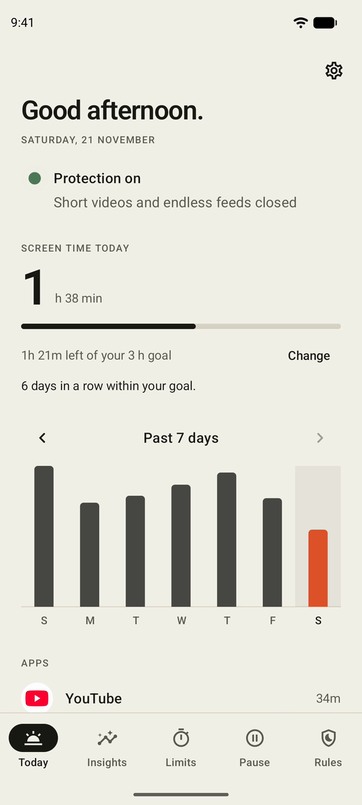
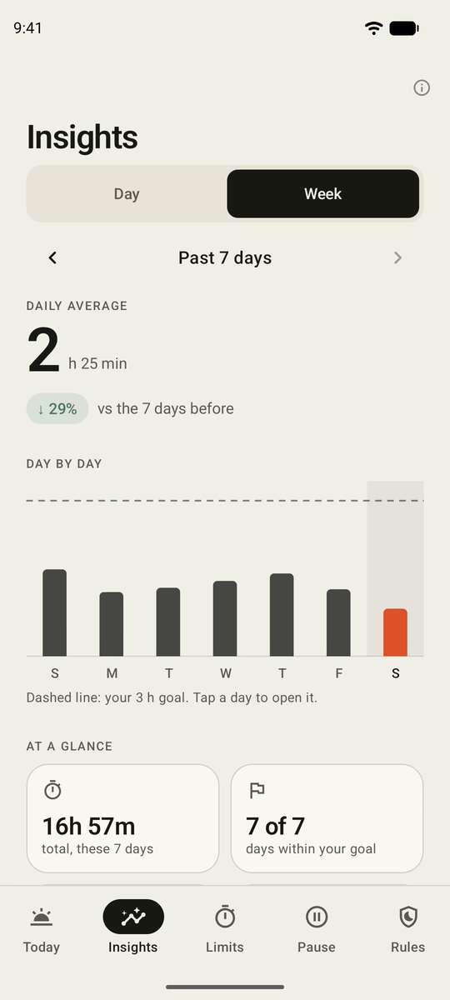
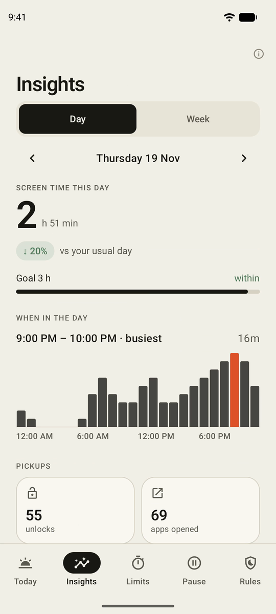
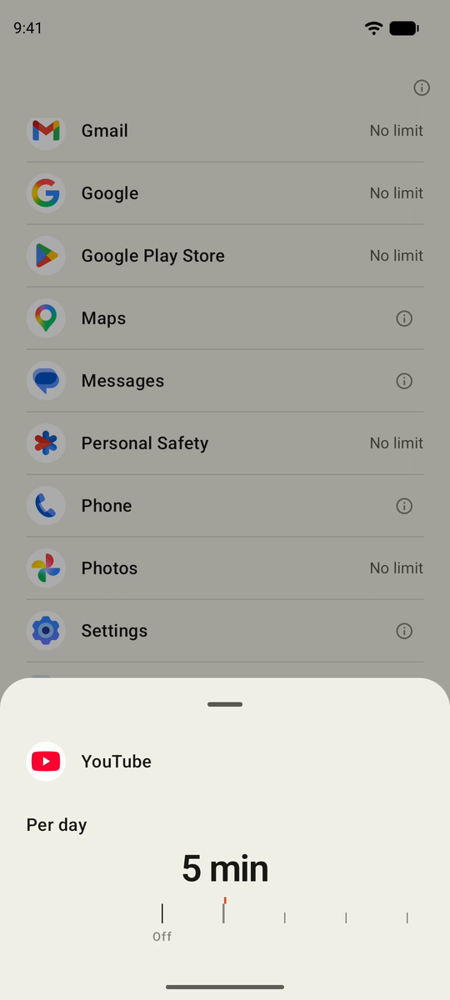
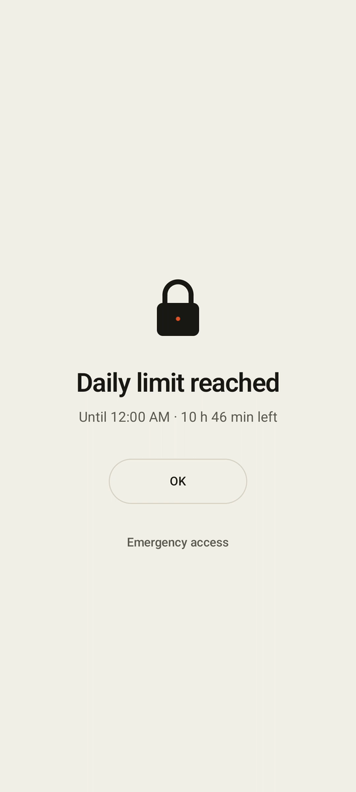
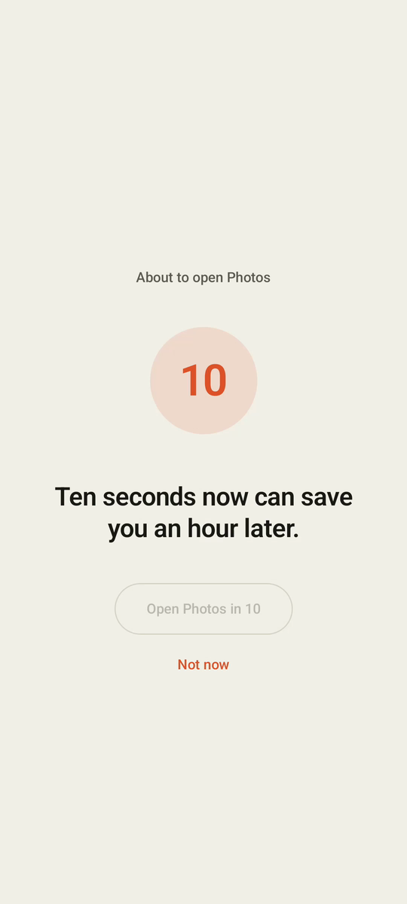
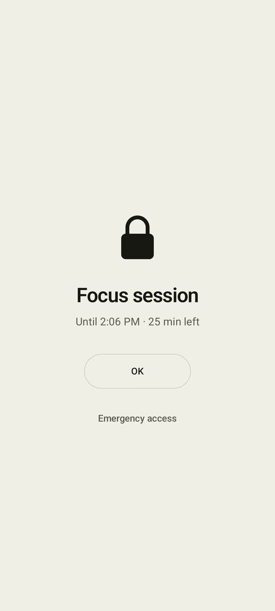
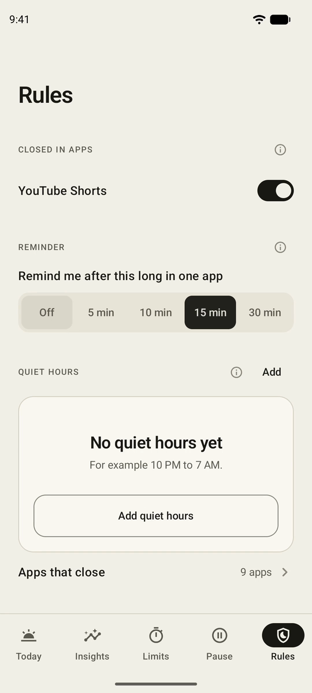

<p align="center"></p>

# Glance

**Use your phone on purpose: a glance, not an hour.**

Glance is an Android app that works alongside the apps you already use. It closes the parts built to keep you scrolling, such as Reels, Shorts, Spotlight and Explore, and gives every app on the phone the time you choose for it. Messages, calls, maps and the things you came for stay open.

It never asks for any login, has no internet permission, and keeps everything on the phone.

## Download

**[Download the latest APK](https://github.com/danish-119/glance/releases/latest)** (Android 8.0 or later). Open the file on your phone to install it; you may need to allow installs from your browser. Each release lists the APK's SHA-256 checksum.

To get notified about updates, add this repo to [Obtainium](https://github.com/ImranR98/Obtainium).

## Screenshots

<p align="center">
  
  
  
  
</p>
<p align="center">
  
  
  
  
</p>

## What it does

**Closes the endless feeds, keeps the rest.** Glance moves you out of short-video feeds before they pull you in:

| App | Closed | Stays open |
|---|---|---|
| Instagram | Reels, Explore, optionally the Home feed | Messages, profiles, search, stories |
| YouTube | Shorts | Videos, search, subscriptions |
| Facebook | Reels, Video/Watch | Feed, groups, profiles |
| Snapchat | Spotlight | Chats, camera, stories, map |

TikTok, X and Reddit can be limited as whole apps.

**And for every app:**

- **Daily limits:** set a time per app; when it's used up, the app closes until midnight.
- **Emergency access:** any locked app opens for 5 minutes, 3 times a day.
- **Pause before opening:** an optional 10-second pause before chosen apps open.
- **Focus sessions:** 25 to 120 minutes with distracting apps closed and notifications held.
- **Quiet hours:** scheduled windows, such as 10 PM to 7 AM, that close chosen apps and hold notifications.
- **Strict mode:** optional; rules can only get stricter while a session or quiet hours are on.
- **Reminders:** a nudge after 5 to 30 minutes in one app.
- **Today and Insights:** screen time per app, a daily goal with a streak, and trends by hour, day and week.
- **Widgets and weekly summary:** screen time and goal on the home screen, and a recap every Monday.

Calls, messages, maps, the camera and other essentials are never blocked.

## Requirements

| | |
|---|---|
| OS | Android 8.0+ (API 26); target API 36 |
| APK size | ~1.7 MB |
| Storage | ~1–3 KB/day of history; < 1 MB at 90-day retention |
| Background | No foreground service, wake locks or screen-off work |
| Network | None (no `INTERNET` permission) |
| Google Play services | Not required |
| Supported apps | Section blocking: Instagram, YouTube, Facebook, Snapchat ([DETECTION.md](docs/DETECTION.md)) |

### Permissions

| Permission | Status | Used for |
|---|---|---|
| Accessibility service | Required | Section and app blocking, limits, quiet hours, focus, pause, reminders |
| Usage access | Optional | Per-app screen time, history, Insights, widget app list |
| Notification access | Optional | Holding notifications of closed apps |
| `POST_NOTIFICATIONS` | Optional (Android 13+) | Weekly summary |

Unlock counts in Insights require Android 9+.

## Build

Requirements: JDK 17+, Android SDK 36.

```sh
./gradlew testDebugUnitTest      # engine unit tests
./gradlew assembleDebug          # app/build/outputs/apk/debug/
./gradlew lintRelease
./gradlew assembleRelease        # signed with keystore.properties
./gradlew bundleRelease          # Play upload bundle
```

The application id is `app.screenbalance`. It is deliberately not the brand name, so the app can be renamed without changing it.

Release signing reads `keystore.properties` at the project root (never committed):

```properties
storeFile=keys/glance-upload.jks
storePassword=…
keyAlias=upload
keyPassword=…
```

## Docs

- [Architecture and technical decisions](docs/ARCHITECTURE.md)
- [Detection: how screens are recognised and how to update it](docs/DETECTION.md)
- [Google Play compliance and privacy policy](docs/PLAY_COMPLIANCE.md)
- [Device test plan](docs/TESTING.md)
- Brand: [mark](docs/brand/glance-mark.svg), [animated mark](docs/brand/glance-mark-animated.svg), [wordmark](docs/brand/glance-wordmark.svg)

## Platform scope

Android only. iOS does not allow apps to see inside other apps: the Screen Time API can shield a whole app, but not just its Reels or Shorts. See [ARCHITECTURE.md](docs/ARCHITECTURE.md#ios).

## License

Copyright (C) 2026 Danish

Glance is free software, licensed under the [GNU General Public License v3.0](LICENSE).
