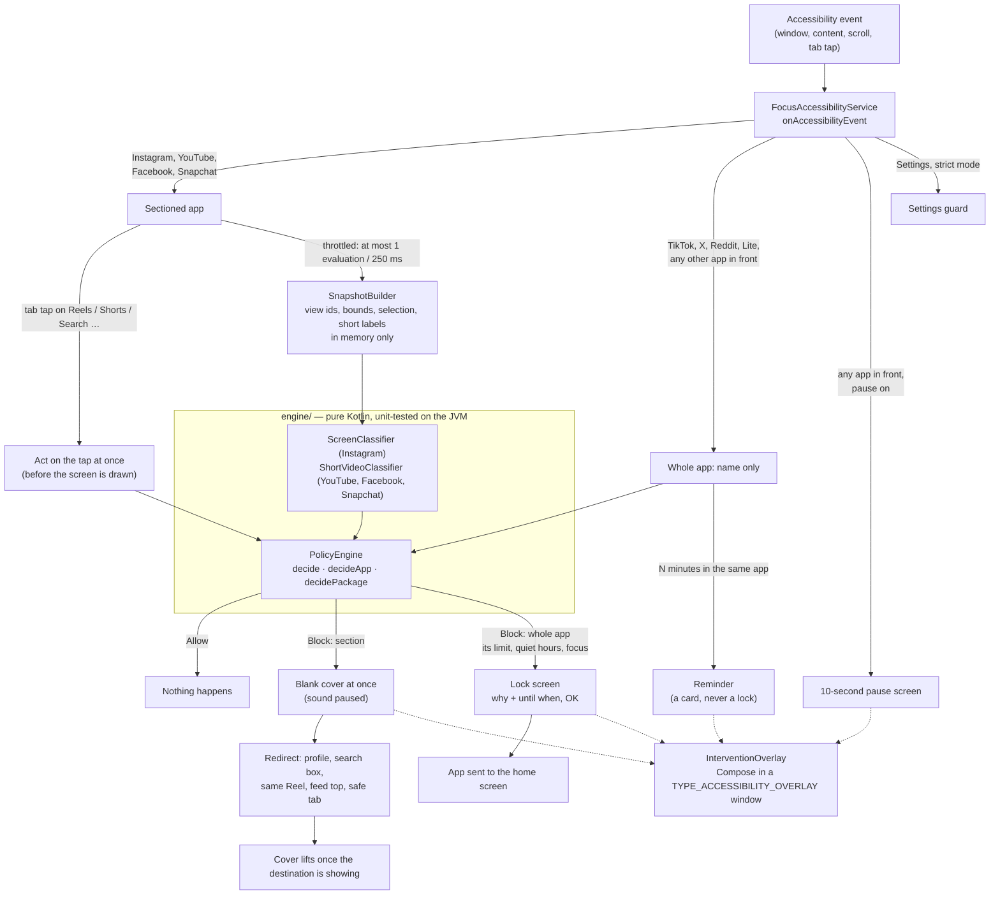

# Architecture and technical decisions

## Choosing the platform mechanism

| Option | Can it tell Reels or Shorts from messages inside an app? | Verdict |
|---|---|---|
| **AccessibilityService** | Yes: it can read the view hierarchy (resource ids, selection state, short labels) of the app in front, and act on it (back, home, click a tab). It also reports which app comes to the front. | **Chosen.** The only Android API that sees *inside* another app. |
| UsageStats API | No: it reports which app is in the foreground and for how long. | Used for accurate daily totals per app (optional permission). |
| Local VPN (`VpnService`) | No: Reels, feed videos and DM videos come from the same CDN hosts over TLS. Blocking by host breaks DMs. | Rejected. Also needs a persistent foreground service (battery) and is a Play policy minefield. |
| Overlay (`SYSTEM_ALERT_WINDOW`) + polling | Only knows the app, not the screen. | Rejected. Accessibility overlays (`TYPE_ACCESSIBILITY_OVERLAY`) give us an overlay without that permission. |
| Device admin / MDM | No in-app visibility. | Rejected; wrong tool and invasive. |
| NotificationListenerService | n/a | Used only to snooze the notifications of apps that are closed. Reads the posting package name, never content. |
| iOS Screen Time (FamilyControls, ManagedSettings, DeviceActivity) | No: apps are opaque tokens; shields apply to the whole app or web domain. | Out of scope (see iOS below). |

## Three kinds of app

| Kind | Apps | What is read | What can happen |
|---|---|---|---|
| Sectioned | Instagram, YouTube, Facebook, Snapchat | View ids, bounds, selection, short labels, tab taps | A section is closed (redirect under a cover); the whole app closes on its limit, quiet hours, focus |
| Whole-app watched | TikTok, X, Reddit, Instagram Lite | The package name in front | Closes on its own limit, quiet hours, focus |
| Any other app with a launcher icon | Everything else, except the essentials | The package name in front, only while quiet hours, a focus session, an app limit or the pause need it | Closes on its limit (if you gave it one), quiet hours, focus; paused before opening if chosen |

**Essentials** (`SystemApps`) are never closed or paused and always notify: home screens, keyboards, the dialer, the default SMS app and messaging apps, contacts, maps, camera, clock, Settings, the system UI and Glance. They are resolved from intents (`CATEGORY_HOME`, `ACTION_DIAL`, `smsto:`, `CATEGORY_APP_MAPS`, …), keeping only preinstalled (system) handlers and the user's chosen default, so they follow the user's own default apps; a third-party app that merely registers for such an intent (Snapchat as a camera, WhatsApp for `smsto:`) is not an essential. Quiet hours and focus sessions close only the apps in `QuietApps` (the seven watched apps by default, or every app with exceptions), so any other app stays usable in an emergency; their notifications are held for every app. Apps without a launcher icon (system dialogs, share sheets, permission screens) are never closed.

## Runtime flow



The overlay goes up first and the app is moved underneath it; the cover lifts only once the destination is showing. Nothing blocked is visible in between, video sound is paused by taking audio focus, nothing loops when the overlay closes, and Android 14+ background-activity-start rules never apply, because no Activity is launched.

### Usage history and Insights

`ScreenTime` reads today live from UsageStats (one read shared for 10 s by Today and both widgets). `UsageHistory` summarises a day from the usage events in one pass: time and opens per app, time per hour, unlocks (`KEYGUARD_HIDDEN`), first pickup and longest visit. Finished days are saved in `stats.db` (`app_day`, `day_info`) because Android keeps that detail for only about a week; the service saves the days Android still has at the first unlock of each day. Everything is kept 90 days and cleared with "Clear usage history". `Insights` is pure arithmetic over 28 `DaySummary`s (this week, the week before, four weekly totals). `GoalStreak` counts days within the daily goal, the same for Today and the goal widget. `WeeklySummaryReceiver` posts Monday's summary from the same data (an inexact, non-wakeup alarm rescheduled each time).

### Widgets

`ScreenTimeWidget` (total and top apps) and `GoalWidget` (a ring toward the goal, time left, streak) are plain RemoteViews. They redraw at each unlock and screen-off (from the service), every 30 minutes, after a non-wakeup alarm just past midnight, on clock or time-zone changes, and (the goal widget) when the goal changes.

`NotificationGate` runs beside the service: it combines settings, the focus session and today's usage per app (shared through `ServiceBridge`) and snoozes notifications: every app's (but the essentials') during quiet hours and focus sessions, and an app's own after its daily limit.

### Packages

```
model/      Serializable settings and runtime state
engine/     Pure Kotlin: app list and signatures, classifiers, trackers, policy, schedules
data/       DataStore settings repository (loosening waits while strict mode applies), SQLite stats and daily history, UsageStats reader, screen time, Insights, goal streak
service/    Accessibility service, notification gate, essentials, snapshot builder, overlay host, usage clocks, phone time, copy, weekly summary
ui/         Compose: theme, components, animated art, onboarding, screens, intervention (lock, pause, reminder cards)
widget/     The "Screen time today" and "Daily goal" home-screen widgets (RemoteViews, no extra library)
```

`engine/` has no Android dependencies, so every decision the app makes is covered by JVM unit tests.

## Key decisions

- **Fail open.** An unrecognised screen is allowed. Wrongly blocking a DM is worse than missing a Reel.
- **Exact id matches only, plus geometry.** A short-video player must cover ≥80% width and ≥55% height. Substring matching is avoided because Instagram's Stories ids contain `reel` and YouTube's home shelf reuses Shorts player ids.
- **Single Reels.** A Reel opened from DMs, a profile or a post plays; the first page change of the pager (after a 600 ms positioning window) counts as a swipe; the pager is scrolled straight back to that Reel under a cover, without pausing its sound (profile as a fallback).
- **Instagram's Home is open or closed, and always ends at "caught up".** Reaching "You've completely caught up", or scrolling past it via "View older posts", jumps the feed back to the top.
- **Redirect, don't lecture.** Sections show no lock screen: Reels and a closed Home → profile; the Search tab → search box; Shorts → Subscriptions or Home; Facebook Reels/Video → Home; Spotlight → Chat or Camera; Back as the fallback. Only whole-app closures and the Settings guard show a lock screen, with an OK button and the time it ends.
- **Blocked means blocked.** There is no "continue anyway" and no self-granted free time.
- **One set of shared controls.** Quiet hours, focus sessions and notification holding apply to every app together; only daily limits are per app.
- **Every app, but only by name.** For apps other than Instagram, YouTube, Facebook and Snapchat, the service reads nothing but the package name of the app in front. It asks Android for events from every app (`serviceInfo.packageNames = null`) only while the pause or the reminder is on, an app limit exists, or quiet hours / a focus session apply to apps beyond the watched ones; otherwise events are limited to the watched apps and Settings.
- **Reminders are soft.** The reminder counts minutes in the app in front, from when it was opened (or the phone unlocked), and shows a full-screen card with a motivation line; "Keep going" closes it. Phone time on Today comes from screen and unlock broadcasts, not from any app.
- **Locked only by choice.** Quiet hours and focus sessions close apps and hold notifications; on their own they lock nothing. `StrictMode` (chosen in advance, per focus sessions / quiet hours) sets `EffectivePolicy.locked`: then `SettingsRepository.updateSettings` rejects changes that `AppSettings.loosens` (including switching strict mode off), a session can't be ended early, and the service bounces the user out of Settings pages that show Glance's own entry.
- **Emergency always works.** `RuntimeState.emergencyUntilMs` (5 min, 3 a day, from the lock card) makes every `decide*` return Allow, strict or not; the essentials never close in the first place.
- **State survives restarts.** Settings and the focus session live in DataStore. Accessibility services are rebound by Android after reboot; no boot receiver, alarms or WorkManager are needed, because every rule is evaluated when an app comes to the front.
- **Battery.** No foreground service, wake locks or polling while nothing managed is in front. A 5-second heartbeat runs only while a managed app is in front, a 30-second phone check only while the phone is unlocked, and stats are flushed once a minute. Every alarm (widgets at midnight, the weekly summary) is inexact and non-wakeup. Today's usage is read once per unlock and shared.
- **Privacy by construction.** No `INTERNET` permission, no backup, only short labels (≤48 chars) read in the sectioned apps, and nothing but aggregates written to disk: minutes per Instagram section, per watched app, per app with a limit, and phone time, per day.
- **Brand-neutral application id.** `app.screenbalance`, so the visible name can change without a new Play listing.
- **No DI framework or Room.** A manual container and `SQLiteOpenHelper` keep the APK small and avoid annotation processing for one table.

## iOS

Apple's Screen Time frameworks (FamilyControls for authorisation, ManagedSettings for shields, DeviceActivity for schedules and thresholds) are the only sanctioned way to restrict other apps. They operate on opaque `ApplicationToken`s and web domains: they cannot see or block a *section* of an app. A faithful iOS version could do the whole-app parts (limits, quiet hours, focus) but not Reels, Shorts or Explore. It would need a Mac, an Apple Developer account, and Apple's Family Controls distribution entitlement. Third-party iOS apps that claim in-app Reels blocking either wrap the website in their own browser (which means handling the user's login) or use network filtering that also breaks DM videos. Both conflict with this project's principles.
